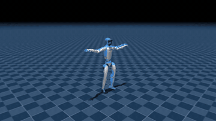
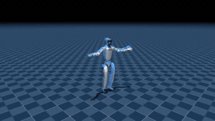
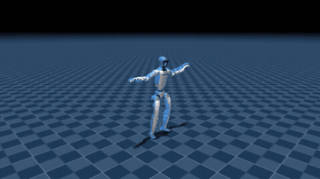

# SuperMimic 复现 · Unitree G1

在新加坡国家超算（NSCC）的一张 A100 上，复现 **SuperMimic**（CoRL 2026）的人形机器人全身动作跟踪：宇树 G1 用**一个策略**跟完 LAFAN1 的全部 40 段人类动作（走、跑、冲刺、跳跃、格斗、跳舞、摔倒起身）。

基于社区复现 [Breezewrf/supermimic_mjlab](https://github.com/Breezewrf/supermimic_mjlab)，上游代码未改动。

<p align="center">
  
</p>
<p align="center"><sub>跳舞片段 · <b>左：上游发布的权重</b> · <b>右：本复现从头训练的权重</b><br>
实体机器人 = 策略在 MuJoCo Warp 物理仿真中的表现；蓝色半透明 = 参考动作；橙色 = 世界模型预测的 0.64 秒后</sub></p>

## 结果

| | 上游报告 | 本复现 | |
|---|---|---|---|
| 评测上游发布的权重 | 40/40 · 0.8528 | **40/40 · 0.8499** | ✅ 完全复现 |
| 从头训练 15000 轮 | 40/40 · 0.8526（A6000，≈4 h） | **40/40 · 0.8523**（A100 40GB，6.5 h） | ✅ 完全复现 |

数字为 40 段动作的成功数 · 平均归一化回报（论文附录 F 协议：每段从首帧完整播放，确定性策略，无噪声与随机化）。判定标准在训练前写定，见[复现报告](docs/REPORT.md)。


第 5000 轮第一次 40 段全部跟完，第 11000 轮起稳定 40/40，回报一路升到 0.852，与上游自己的训练结果（0.8526）几乎一样。


走路最容易（0.90），摔倒后起身最难（0.80）；自训模型与上游发布权重在各类动作上相差都在 ±0.02 以内。

### 更多片段（本复现自己训练的权重）

<p align="center">
  
  
  
</p>
<p align="center"><sub>摔倒后起身 · 跳跃 · 冲刺</sub></p>

与上游权重的左右对比：[摔倒起身](docs/assets/gifs/fallAndGetUp1_subject1_author_vs_mine.gif) · [跳跃](docs/assets/gifs/jumps1_subject1_author_vs_mine.gif) · [冲刺](docs/assets/gifs/sprint1_subject2_author_vs_mine.gif)。GIF 由 [`scripts/nscc/make_gifs.sh`](scripts/nscc/make_gifs.sh) 从评测视频截取（每段 8 秒、12 fps）。

## SuperMimic 在做什么

传统做法用 PPO 在仿真里试错，动作一多就要海量 GPU。SuperMimic 先学一个**可微的世界模型**（所有动作共用同一套机器人动力学），再让策略在世界模型里"想象"32 步、沿想象轨迹直接反向传播求梯度（BPTT）。论文报告：单卡 3 小时超过 128 卡训练 7 天的基线，GPU·小时少 1000 倍以上。

## 怎么复现

环境：Linux + NVIDIA GPU（Ampere 及以上），Python 3.11，[uv](https://docs.astral.sh/uv/)。

```bash
# 1. 上游代码与环境
git clone https://github.com/Breezewrf/supermimic_mjlab && cd supermimic_mjlab
uv sync
# 驱动 < 580（例如 NSCC 的 570）时，把 torch 换成 CUDA 12.6 构建，之后不要再 uv sync：
uv pip install --python .venv/bin/python --reinstall-package torch "torch==2.14.1+cu126" \
  --index-url https://pypi.org/simple --extra-index-url https://download.pytorch.org/whl/cu126

# 2. LAFAN1 的 G1 重定向数据（40 段）→ 50 Hz NPZ
uvx --python 3.11 --from 'huggingface_hub>=0.34' hf download lvhaidong/LAFAN1_Retargeting_Dataset \
  --repo-type dataset --include "g1/*" --local-dir lafan_raw
mkdir -p src/assets/motions/LAFAN1_Retargeting_Dataset && cp lafan_raw/g1/*.csv src/assets/motions/LAFAN1_Retargeting_Dataset/
.venv/bin/python scripts/data/convert_lafan_to_npz.py

# 3. 评测 / 训练 / 导出视频：见 scripts/nscc/ 下的 PBS 脚本（PBS Pro；其他集群改作业头即可）
#    sm_check_eval.pbs  环境检查 + 评测发布权重 + 视频
#    sm_train.pbs       上游最佳配置从头训练 15000 轮（显存峰值约 33.5 GB）
#    sm_videos.pbs      导出 6 段 × 2 版视频（自动使用 imageio-ffmpeg 自带的 ffmpeg）
```

完整的环境、配置、逐轮结果和 8 个踩坑记录见 **[复现报告](docs/REPORT.md)**。

## 仓库结构

| 路径 | 内容 |
|---|---|
| [`docs/REPORT.md`](docs/REPORT.md) | 复现报告 |
| [`docs/assets/`](docs/assets/) | 图（由 [`scripts/analysis/make_figures.py`](scripts/analysis/make_figures.py) 从仓库内的评测 JSON 生成）和演示 GIF |
| [`scripts/nscc/`](scripts/nscc/) | PBS 作业脚本（评测、训练、导出视频）、GIF 生成脚本 |
| [`scripts/local/`](scripts/local/) | 本地（CPU）交互回放脚本 |
| [`results/`](results/) | 评测结果原始数据：上游发布权重的评测、本次训练每 1000 轮的评测、训练配置 |

## 致谢与许可

- 方法：Q. Liao, Y. Shao, J. Long, K. Zakka, R. Horowitz, P. Abbeel, K. Sreenath. *SuperMimic: Scaling Humanoid Whole-Body Control with One Differentiable World Model*. CoRL 2026, [arXiv 2610.28480](https://arxiv.org/abs/2610.28480).
- 代码：[Breezewrf/supermimic_mjlab](https://github.com/Breezewrf/supermimic_mjlab)。
- 数据：LAFAN1（Ubisoft La Forge，CC BY-NC-ND 4.0）；G1 重定向与模型（Unitree，BSD-3-Clause）。本仓库不分发动作数据与模型权重，图像与视频中的参考动作仅作非商业展示。
- 计算：NSCC Singapore ASPIRE 2A。
