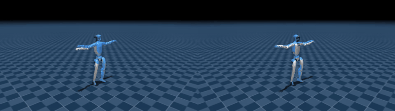
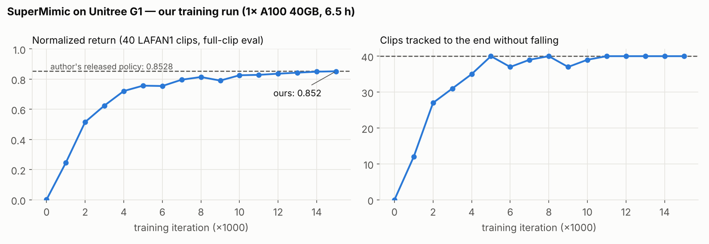
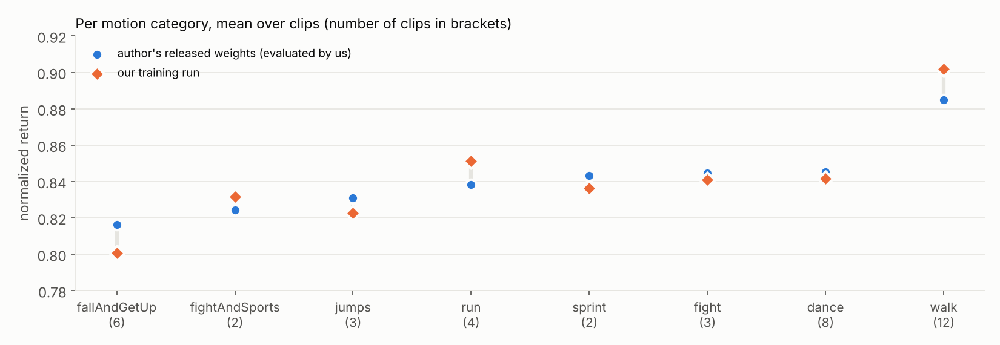
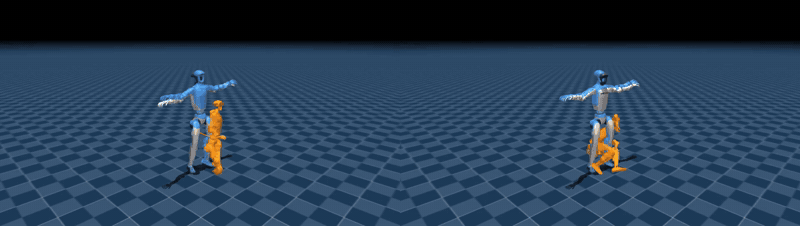

# SuperMimic 复现：基于可微世界模型的人形机器人全身动作跟踪（Unitree G1）

**摘要**　本仓库对 SuperMimic（Liao et al., CoRL 2026）在 LAFAN1 动作集上的单卡实验进行独立复现。实验以社区实现 [supermimic_mjlab](https://github.com/Breezewrf/supermimic_mjlab) 为基础（未修改上游代码），在 Unitree G1（29 自由度）上训练单一的全身动作跟踪策略，覆盖 40 段人类动作（共 2.45 h）。我们在 NSCC ASPIRE 2A 的单张 NVIDIA A100-40GB 上完成两项实验：（A）评测上游发布的权重，（B）以上游最佳配置从零训练 15,000 轮。两项实验均达到 40/40 的动作完成率，归一化回报分别为 0.8499 与 0.8523，与上游报告值（0.8528、0.8526）的偏差均小于 0.003，满足实验前设定的"完全复现"标准。此外，我们对世界模型的长程（0.64 s）开环预测误差进行了定量分析。

<p align="center">
  
</p>
<p align="center"><sub><b>图 1</b>　摔倒后起身片段（fallAndGetUp1_subject1）。左：上游发布的权重；右：本复现从零训练的权重。实体模型为策略在 MuJoCo Warp 物理仿真中的执行结果，蓝色半透明模型为参考动作。</sub></p>

## 1. 背景与方法

基于动作捕捉数据的动作跟踪（motion tracking）是获得通用人形机器人全身控制的主流途径。现有方法多采用无模型强化学习（如 PPO）：或先为各动作训练专家策略再进行有损蒸馏，或以集群规模的算力直接训练单一策略，随动作数量增加，计算代价迅速上升。

SuperMimic 的核心思想是**以一个可微的世界模型摊销所有动作共享的动力学**。训练循环交替执行三个步骤：

1. **仿真采样**：在 4,096 个并行环境（MuJoCo Warp）中执行当前策略，将转移存入回放缓冲区；
2. **世界模型拟合**：以 8 步自回归窗口拟合机器人动力学（MLP，2048×3）；
3. **策略优化**：自缓冲区中的真实状态出发，在世界模型中展开 H = 32 步想象轨迹，经时间反向传播（BPTT）获得解析梯度，并以 GAE(λ = 0.95) 训练的价值函数对截断处的回报进行自举。

论文报告，该方法在单卡 3 小时内即超过以 128 张 GPU 训练 7 天的基线，GPU·小时降低三个数量级以上。世界模型仅在训练阶段使用，部署时只需策略网络。

## 2. 实验设置

**机器人与数据**　Unitree G1 29 自由度模型（`g1_29dof_rev_1_0`，关闭自碰撞）；LAFAN1 的 G1 重定向数据（[`lvhaidong/LAFAN1_Retargeting_Dataset`](https://huggingface.co/datasets/lvhaidong/LAFAN1_Retargeting_Dataset)），共 40 段、2.45 h，由 30 Hz 重采样至 50 Hz 控制频率。

**训练配置**　与上游最佳配置一致（[`results/training/config.json`](results/training/config.json)）：

| 项 | 取值 |
|---|---|
| 并行环境 / 回放容量 | 4,096 / 每环境 1,000 步 |
| 想象步长 H / 折扣 γ / GAE λ | 32 / 0.99 / 0.95 |
| 世界模型 | MLP 2048-2048-2048，预测状态增量，8 步自回归损失 |
| 策略 / 价值网络 | MLP 2048-1024-512-256 / 256-128 |
| 优化 | Adam，学习率 2×10⁻⁴（余弦衰减），策略批量 4,096，世界模型批量 10×2,048 |
| 观测与归一化 | 全身参考特征（2,680 维）、`motion_anchor_ori_b`、Actor/Critic 输入归一化、世界模型归一化 |
| 精度 / 训练轮数 | FP32（矩阵乘法启用 TF32）/ 15,000 轮 |

**评测协议**　遵循论文附录 F：每段动作从首帧开始完整播放一次；确定性策略；摩擦系数 1.0；关闭观测噪声、动作噪声与域随机化；根部高度或倾角越界即判定失败。单段归一化回报定义为未折扣奖励除以 5·Δt·(T−1)（Δt = 0.02 s，T 为帧数），报告 40 段的算术平均。

**判定标准（实验前设定）**　(A) 成功 ≥ 39/40 且回报 ≥ 0.84 为通过，40/40 且回报落在 0.8528 ± 0.005 内为完全复现；(B) 成功 ≥ 38/40 且回报 ≥ 0.80 为通过，40/40 且回报 ≥ 0.84 为完全复现。

**计算环境**　NSCC ASPIRE 2A，单张 A100-SXM4-40GB（驱动 570，CUDA 12.8）；Python 3.11，PyTorch 2.14.1+cu126，mjlab 1.2.0，MuJoCo 3.16.0，MuJoCo Warp 3.8.1，Warp 1.12.0。

## 3. 结果

### 3.1 主要结果

| 实验 | 上游报告 | 本复现 | 判定 |
|---|---|---|---|
| (A) 评测上游发布的权重 | 40/40，0.8528 | **40/40，0.8499** | 完全复现 |
| (B) 从零训练 15,000 轮 | 40/40，0.8526（RTX A6000 48GB，约 4 h） | **40/40，0.8523**（A100 40GB，6.5 h） | 完全复现 |

表中数值为"成功动作数，平均归一化回报"。(B) 的最佳检查点即第 15,000 轮；训练期显存峰值 33.45 GiB，吞吐约 7,500–8,500 transitions/s。

### 3.2 训练动态



<sub><b>图 2</b>　每 1,000 轮的全量评测结果。左：平均归一化回报（虚线为上游发布权重的 0.8528）；右：完整跟踪至结束且未失败的动作数。</sub>

策略在第 5,000 轮首次完成全部 40 段动作，自第 11,000 轮起稳定保持 40/40；回报在第 6,000 与 9,000 轮出现小幅回落后持续上升，最终收敛至 0.852。训练末期世界模型 8 步损失为 0.009，训练过程中的失败率降至 0.00%。

### 3.3 按动作类别的比较



<sub><b>图 3</b>　各动作类别的平均归一化回报（括号内为片段数）。</sub>

行走类动作表现最好（本复现 0.902），摔倒后起身最具挑战（0.801）。本复现与上游权重在各类别上的差异均在 ±0.02 以内：在 walk、run、fightAndSports 上略高，在 fallAndGetUp、jumps、sprint 上略低。

### 3.4 跟踪误差

| 指标（40 段平均） | 上游发布的权重 | 本复现 |
|---|---|---|
| 身体位置误差 | 3.8 cm | 4.0 cm |
| 身体朝向误差 | 0.139 rad | 0.159 rad |
| 根部朝向误差 | 0.063 rad | 0.079 rad |
| 根部位置误差（全局漂移） | 0.74 m | 0.46 m |

局部跟踪精度处于同一水平；主要误差来源为根部的全局漂移，这是策略仅依赖本体感知、不观测全局位置的直接结果。

### 3.5 世界模型的长程预测

<p align="center">
  
</p>
<p align="center"><sub><b>图 4</b>　跳舞片段（dance2_subject1）。橙色模型为世界模型自当前真实状态出发、由策略在模型内闭环推演 32 步（0.64 s）后的预测姿态。左：上游权重；右：本复现权重。</sub></p>

| 0.64 s 预测与同一时刻真实状态之差（6 段平均） | 根部位置 | 根部朝向 | 身体各部位平均位置（MPJPE） |
|---|---|---|---|
| 上游发布的权重 | 0.49 m | 0.79 rad | 0.50 m |
| 本复现 | 0.43 m | 0.99 rad | 0.46 m |

两组权重的长程预测误差处于同一量级，表明这一现象源于方法本身而非复现偏差。世界模型以 8 步（0.16 s）窗口训练，32 步推演相当于 4 倍外推；且推演过程中策略作用于预测状态，误差随步数累积，一旦偏离训练分布便可能产生不符合物理的姿态。尽管如此，策略优化仍然有效：想象轨迹始终以真实状态为起点，主要提供局部梯度方向；远端步数按预测存活概率降权，并由价值函数自举；最终性能完全在物理仿真中评测。

### 3.6 定性结果

<p align="center">
  
  
</p>
<p align="center"><sub><b>图 5</b>　本复现权重在跳跃（左）与冲刺（右）片段上的表现。与上游权重的对比：<a href="docs/assets/gifs/jumps1_subject1_author_vs_mine.gif">跳跃</a> · <a href="docs/assets/gifs/sprint1_subject2_author_vs_mine.gif">冲刺</a>。</sub></p>

## 4. 讨论与局限

- **训练时长**　本复现训练耗时 6.5 h，高于上游报告的约 4 h。其中约 1 h 用于每 1,000 轮一次的全量评测（16 次，每次约 4 min），其余差异可能来自硬件（A100 与 RTX A6000 的 FP32 吞吐差异）及并行负载。
- **统计显著性**　仅进行了单个随机种子（seed = 0）的训练，未估计种子间方差。
- **实验规模**　仅复现了 LAFAN1（40 段）的单卡实验，未涉及论文中 BONES-SEED（约 13 万段动作）的大规模实验与 SONIC 基线比较。
- **实现来源**　论文未公开官方代码，本复现基于社区实现，结论反映的是该实现在论文协议下的表现。
- **仿真到实机**　所有结果均在仿真中获得，评测时关闭噪声与域随机化，未进行实机部署。

## 5. 复现步骤

环境要求：Linux，NVIDIA GPU（Ampere 及以上），Python 3.11，[uv](https://docs.astral.sh/uv/)。

```bash
# 1. 上游代码与环境
git clone https://github.com/Breezewrf/supermimic_mjlab && cd supermimic_mjlab
uv sync
# 若驱动 < 580（如 NSCC 的 570），改用 CUDA 12.6 构建的 PyTorch；此后不要再执行 uv sync：
uv pip install --python .venv/bin/python --reinstall-package torch "torch==2.14.1+cu126" \
  --index-url https://pypi.org/simple --extra-index-url https://download.pytorch.org/whl/cu126

# 2. 数据：LAFAN1 的 G1 重定向（40 段）→ 50 Hz NPZ
uvx --python 3.11 --from 'huggingface_hub>=0.34' hf download lvhaidong/LAFAN1_Retargeting_Dataset \
  --repo-type dataset --include "g1/*" --local-dir lafan_raw
mkdir -p src/assets/motions/LAFAN1_Retargeting_Dataset && cp lafan_raw/g1/*.csv src/assets/motions/LAFAN1_Retargeting_Dataset/
.venv/bin/python scripts/data/convert_lafan_to_npz.py

# 3. 评测、训练与视频导出：见 scripts/nscc/ 中的 PBS 作业脚本（PBS Pro；其他调度系统修改作业头即可）
#    sm_check_eval.pbs  环境检查、评测发布权重、导出视频
#    sm_train.pbs       上游最佳配置从零训练 15,000 轮
#    sm_videos.pbs      导出 6 段 × 2 版评测视频
```

图 2、图 3 可由 `python scripts/analysis/make_figures.py` 从 [`results/`](results/) 中的评测数据重新生成。环境配置细节与工程问题记录见[复现报告](docs/REPORT.md)。

## 6. 仓库结构

| 路径 | 内容 |
|---|---|
| [`docs/REPORT.md`](docs/REPORT.md) | 复现报告（逐轮结果、误差分析、工程问题记录） |
| [`docs/assets/`](docs/assets/) | 图与演示动图 |
| [`results/author_released/`](results/author_released/) | 上游发布权重的评测结果 |
| [`results/training/`](results/training/) | 本次训练的配置、最佳检查点信息及每 1,000 轮的评测结果 |
| [`scripts/nscc/`](scripts/nscc/) | 评测、训练、视频导出的 PBS 作业脚本，动图生成脚本 |
| [`scripts/analysis/`](scripts/analysis/) | 绘图脚本 |
| [`scripts/local/`](scripts/local/) | 本地（CPU）交互式回放脚本 |

## 7. 引用

本仓库为复现工作，请引用原论文：

```bibtex
@inproceedings{liao2026supermimic,
  title         = {SuperMimic: Scaling Humanoid Whole-Body Control with One Differentiable World Model},
  author        = {Liao, Qiayuan and Shao, Yiyang and Long, Junfeng and Zakka, Kevin and Horowitz, Roberto and Abbeel, Pieter and Sreenath, Koushil},
  booktitle     = {Conference on Robot Learning (CoRL)},
  year          = {2026},
  eprint        = {2610.28480},
  archivePrefix = {arXiv}
}
```

## 8. 致谢与许可

- 代码实现：[Breezewrf/supermimic_mjlab](https://github.com/Breezewrf/supermimic_mjlab)。
- 数据：LAFAN1（Ubisoft La Forge，CC BY-NC-ND 4.0）；G1 重定向数据与机器人模型（Unitree，BSD-3-Clause）。本仓库不分发动作数据与模型权重，图与动图中的参考动作仅用于非商业的学术展示。
- 计算资源：新加坡国家超算中心（NSCC Singapore）ASPIRE 2A。
