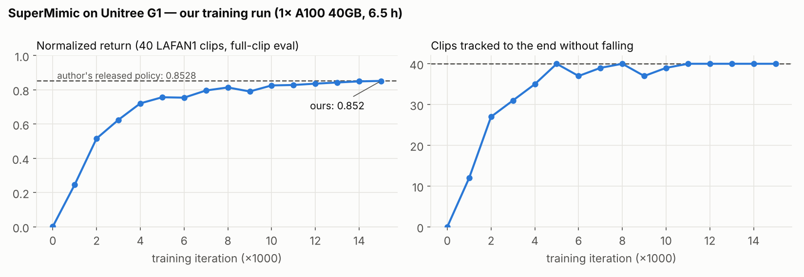
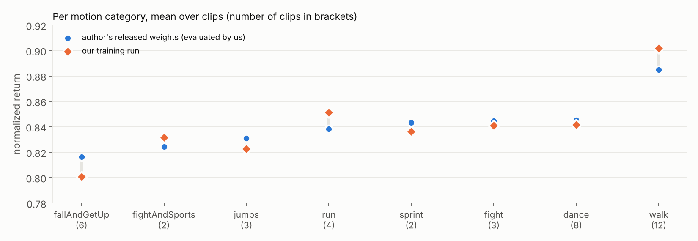
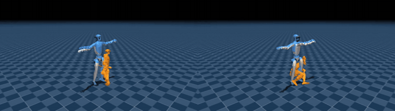

# SuperMimic 复现报告（Unitree G1 · LAFAN1 · NSCC A100）

- 时间：2026-11-02 至 2026-11-05
- 复现对象：SuperMimic: Scaling Humanoid Whole-Body Control with One Differentiable World Model（Liao et al., CoRL 2026, arXiv 2610.28480）
- 使用的代码：社区复现 [Breezewrf/supermimic_mjlab](https://github.com/Breezewrf/supermimic_mjlab)（commit `a7cee74`），未改动上游代码
- 计算：新加坡国家超算中心（NSCC）ASPIRE 2A，单卡 NVIDIA A100-SXM4-40GB
- 结论：**两项判定标准均达到"完全复现"**

## 1. 判定标准（开始前写定，看完结果未改）

| 编号 | 内容 | 通过 | 完全复现 |
|---|---|---|---|
| A | 在 NSCC 上评测上游发布的权重 | ≥ 39/40 且回报 ≥ 0.84 | 40/40 且回报 0.8528 ± 0.005 |
| B | 用上游最佳配置从头训练 15000 轮 | ≥ 38/40 且回报 ≥ 0.80 | 40/40 且回报 ≥ 0.84 |

评测协议（论文附录 F）：40 段动作各从第一帧开始完整播放一次；确定性策略；摩擦 1.0；无噪声、无域随机化；高度或倾斜越界即判失败。归一化回报 = 每段未折扣奖励 / (5 × 控制周期 × (帧数 − 1))，再对 40 段取平均。

## 2. 结果

| | 上游报告 | 本次 | 判定 |
|---|---|---|---|
| A：发布权重评测 | 40/40，0.8528 | **40/40，0.8499**（逐帧 0.8514） | 完全复现 |
| B：从头训练 | 40/40，0.8526（A6000 48GB，约 4 h） | **40/40，0.8523**（逐帧 0.8548；A100 40GB，6 h 33 min） | 完全复现 |

### 2.1 训练过程（每 1000 轮全量评测）

| 轮数（千） | 0 | 1 | 2 | 3 | 4 | 5 | 6 | 7 | 8 | 9 | 10 | 11 | 12 | 13 | 14 | 15 |
|---|---|---|---|---|---|---|---|---|---|---|---|---|---|---|---|---|
| 成功 /40 | 0 | 12 | 27 | 31 | 35 | 40 | 37 | 39 | 40 | 37 | 39 | 40 | 40 | 40 | 40 | 40 |
| 回报 | 0.002 | 0.246 | 0.516 | 0.625 | 0.721 | 0.757 | 0.755 | 0.796 | 0.814 | 0.791 | 0.826 | 0.829 | 0.836 | 0.843 | 0.850 | 0.852 |

最佳权重即第 15000 轮（选择规则：先比成功数，再比回报）。训练末期：世界模型损失 0.009，想象回报 8.55，训练中摔倒率 0.00%。

### 2.2 跟踪误差（40 段平均）

| 指标 | 上游发布权重 | 自训 |
|---|---|---|
| 身体位置误差 | 3.8 cm | 4.0 cm |
| 身体朝向误差 | 0.139 rad（≈ 8°） | 0.159 rad（≈ 9°） |
| 根部朝向误差 | 0.063 rad | 0.079 rad |
| 根部位置误差（全局漂移） | 0.74 m | 0.46 m |

按类别：走路最好（自训 0.902），摔倒起身最难（0.801）；自训在 walk、run、fightAndSports 上略高，在 fallAndGetUp、jumps、sprint 上略低，差距都在 ±0.02 内。

### 2.3 演示

左：上游发布的权重；右：本复现自训权重（跳舞，带世界模型 +0.64 s 预测）。更多：[摔倒起身](assets/gifs/fallAndGetUp1_subject1_author_vs_mine.gif)、[跳跃](assets/gifs/jumps1_subject1_author_vs_mine.gif)、[冲刺](assets/gifs/sprint1_subject2_author_vs_mine.gif)。

两组权重各导出 6 段（走、跑、冲刺、跳舞、跳跃、摔倒起身）× 2 版（普通 / 叠加世界模型预测）的 20 s 视频（960×540，50 fps），保存在 NSCC，不进仓库。

## 3. 环境与配置

| 项 | 值 |
|---|---|
| 机器人 | Unitree G1 29 DoF（`g1_29dof_rev_1_0`），关闭自碰撞 |
| 数据 | LAFAN1 G1 重定向（HF `lvhaidong/LAFAN1_Retargeting_Dataset`，`g1/`），40 段，30 → 50 Hz |
| 软件 | Python 3.11、torch 2.14.1+cu126、mjlab 1.2.0、mujoco 3.16.0、mujoco-warp 3.8.1、warp-lang 1.12.0 |
| GPU | A100-SXM4-40GB，驱动 570.124.06（CUDA 12.8） |
| 训练配置 | 4096 env、replay 1000、H=32、世界模型 MLP 2048×3、actor 2048-1024-512-256、critic 256-128、lr 2e-4、FP32（开 TF32）、Actor/Critic 输入归一化、世界模型归一化、`motion_anchor_ori_b`，15000 轮 |
| 显存峰值 | 33.45 GiB |
| 速度 | 约 1.2–1.4 s/轮（≈ 7,500–8,500 transitions/s） |
| 花费 | 全部 GPU 作业约 7.1 GPU·小时 ≈ 457 SU |

完整命令见 [`scripts/nscc/sm_train.pbs`](../scripts/nscc/sm_train.pbs)，配置原文见 [`results/training/config.json`](../results/training/config.json)，每 1000 轮的评测结果见 [`results/training/`](../results/training/)。

## 4. 踩坑与解决

| # | 现象 | 原因 | 解决 |
|---|---|---|---|
| 1 | `uvx` 装不出 `hf` 命令 | 集群系统 Python 是 3.6.8 | `uvx --python 3.11 --from 'huggingface_hub>=0.34' hf ...` |
| 2 | `torch.cuda.is_available()` 为 False | PyPI 的 torch 2.14.1 是 CUDA 13.0 构建，需驱动 ≥ 580；节点是 570 | 换 `torch==2.14.1+cu126` |
| 3 | 换 torch 后仍是 cu130 | uv 中 `--extra-index-url` 优先于 `--index-url`，且默认只用第一个有该包的索引 | 版本写死 `+cu126`，cu126 索引放 `--extra-index-url` |
| 4 | 换完 torch 不能再 `uv sync` | `uv sync` 会按 `uv.lock` 换回 cu130 | 作业里直接 `source .venv/bin/activate` |
| 5 | 视频导出 `FileNotFoundError: ffmpeg` | 计算节点没有系统 ffmpeg | 用 `imageio-ffmpeg` 自带二进制临时放进 PATH（`sm_videos.pbs`） |
| 6 | 训练报 `Output exists` | 训练脚本要求 `--output` 目录事先不存在，作业脚本先建了它 | 日志放上一级，`--output` 交给训练脚本创建 |
| 7 | 回放窗口只占 1/4 屏 | Ubuntu Wayland + 缩放 | 改 100% 缩放，或 `PYGLFW_LIBRARY_VARIANT=wayland` |
| 8 | 视频 JSON 显示 `successes: 0` | 视频只取前 20 s，`evaluation_limited` 时不计成功、回报按全长归一化 | 属正常；按 20 s 折算回报 0.87–0.96 |

## 5. 致谢与许可

- 方法：Q. Liao, Y. Shao, J. Long, K. Zakka, R. Horowitz, P. Abbeel, K. Sreenath, *SuperMimic*, CoRL 2026, arXiv 2610.28480。
- 代码：[Breezewrf/supermimic_mjlab](https://github.com/Breezewrf/supermimic_mjlab)（本仓库只调用，不包含其代码）。
- 数据：LAFAN1（Ubisoft La Forge，CC BY-NC-ND 4.0）；G1 重定向与模型（Unitree，BSD-3-Clause）。本仓库不分发动作数据和权重；图中和视频里的参考动作仅作非商业展示。
- 计算：NSCC Singapore ASPIRE 2A。
